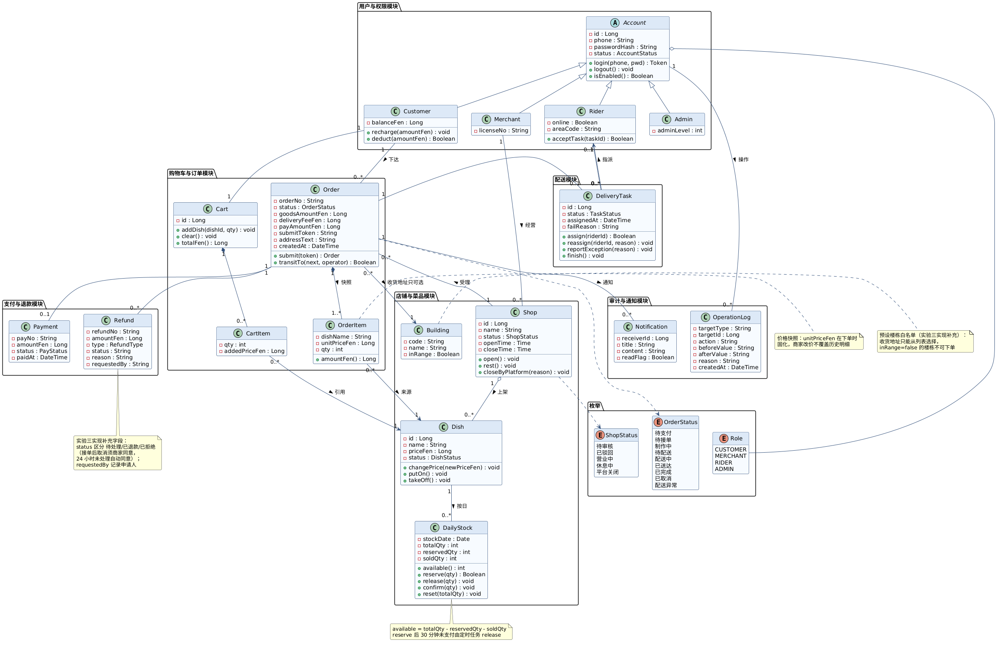
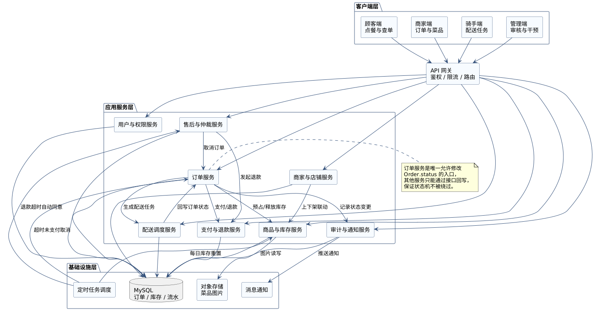
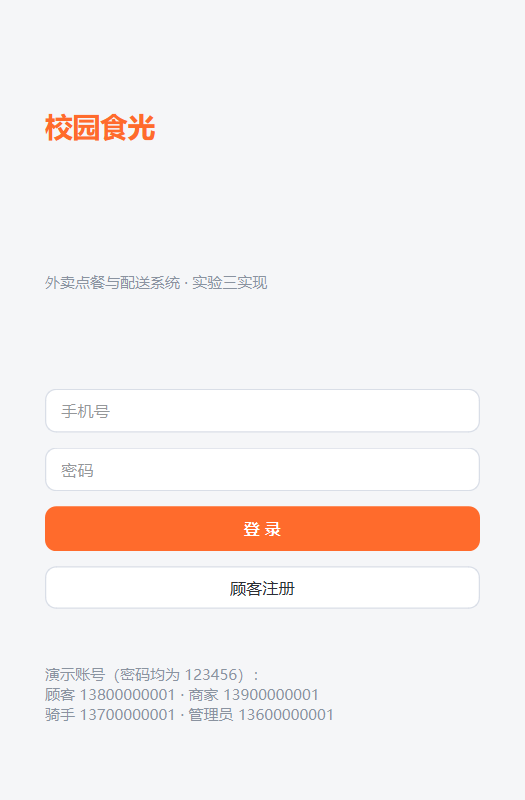
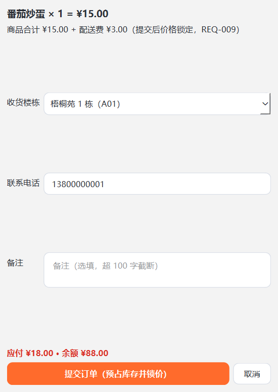
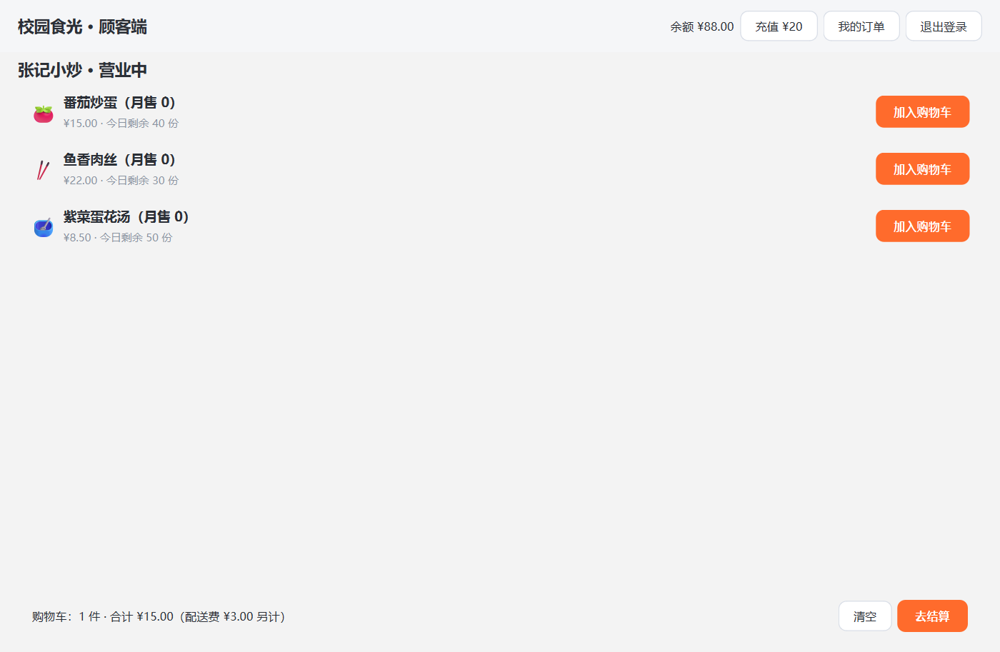
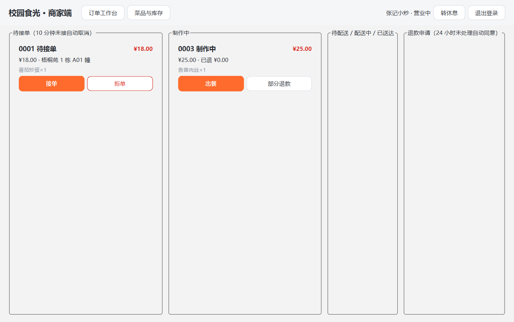
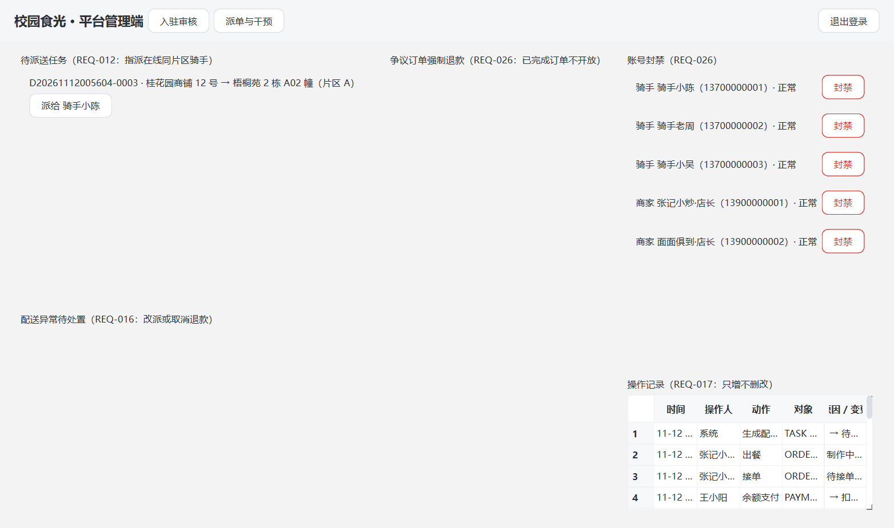

# 实验三 软件实现与构建报告

项目名称：外卖点餐与配送系统（校园食光）
学号：241880548　姓名：王睿阳　日期：2026 年 11 月

## 一、实现概述

本项目延续实验一的需求分析与实验二的设计建模，选题不变：单校区外卖点餐与配送系统「校园食光」，覆盖顾客、商家、配送人员、平台管理员四类角色。实验三的任务是把实验二的 8 张 UML 图落地为可运行的软件。

整体架构按实验二组件图同进程落地，共四层：

| 层 | 代码位置 | 职责 |
| --- | --- | --- |
| 客户端层 | campus_eats/ui | 四角色界面 + 登录，只经网关调服务 |
| 网关 | services/gateway.py | 会话管理、角色鉴权（REQ-001） |
| 应用服务层 | campus_eats/services | 网关 + 八个领域服务 + 调度器 + 时钟 |
| 基础设施层 | campus_eats/repositories | SQLite 仓储，对应组件图的数据库 |


## 二、UML 到代码的转换

### 1 类图 → 领域模型

类图六个包逐一映射为 models/ 下的模块：用户与权限（account.py）、店铺与菜品（shop_dish.py）、购物车与订单（cart_order.py）、支付与退款（payment_refund.py）、配送（delivery.py）、审计与通知（audit.py），枚举集中在 enums.py。

对于独立UML图中每个箭头，转换成状态机状态的改变，而组件图本身翻译为目录结构和服务类。状态转换就是方法调用，对于会相互依赖的服务，我采用类似dsh的总线思想，每个服务类是一个插件，互相不干扰，独立构造，最后用app.py黏合到一起。同时各个uml图之间的联系与状态转变也被放到总线管控，这样可以保证模块的独立性和流程的可读性较好；

### 2 与设计的差异及回改

实现与实验二设计有五处出入，按实验二报告第 6 章的约定"以实现为准回改设计"，类图已更新并重新渲染（提交 7949c53）：

1. OrderStatus 补「配送异常」挂起态——状态图里有、类图枚举漏了
2. ShopStatus 补「待审核 / 已驳回」前置态——REQ-002 的入驻审核流程需要
3. 新增 Building 预设楼栋类——REQ-008 要求地址只能从白名单选择
4. Refund 补 status / requestedBy 字段——"24 小时未处理自动同意"需要退款状态机
5. login / acceptTask 两个方法从实体移入服务

### 3 代码规模

[[land]]


[[land]]


规模统计（build/count_lines.py，口径：代码行 = 含非注释 token 的物理行去重）：

| 目录 | 文件数 | 总行数 | 代码行 |
| --- | --- | --- | --- |
| campus_eats | 44 | 5806 | 4430 |
| tests | 7 | 868 | 717 |
| scripts | 2 | 388 | 309 |
| 合计 | 53 | 7062 | 5456 |

满足"大于 1500 行"的要求，其中不含任何 GUI 设计工具生成物——界面全部为手写 QSS 与布局代码。

### 4 大模型辅助开发过程

#### 1 分工与工作流

本次实验使用 ZCode（CLI Agent，模型 GLM）。分工与实验二一脉相承：**我负责总体架构与核心思路控制**——我先确定软件架构与每个服务的大致实现思路，具体代码生成由模型处理；**模型承担实现主体**——从领域模型、仓储、八个服务到 PySide6 界面与测试的代码产出；**自动检查链兜底**——pylint 静态检查、离屏界面冒烟、32 项端到端验收、63 项 pytest，每层产物先过检查再进下一层。

#### 2 主要使用记录

**记录一：实现计划与选型。** 把题目、27 条需求、8 张 UML 源码交给模型要求给出计划并列出需要人工拍板的决策点，同时告诉模型这个项目的总体架构组成，独立构建每个类的服务；

**记录二：提供服务类实现思路** 对于每个服务类的实现，都在模型开始工作前提供大致思路，避免模型使用不受掌控的逻辑构建代码，加强代码的可控性；

**记录三：设计类CI流程** 为了进一步保证软件质量，告诉ai要设计类似CI的自动化检测与单元测试脚本，这样可以控制ai的幻觉。如每层代码写完、提交之前，固定跑一组自动检查，pylint 打分等；

#### 3 生成内容不符合预期时的处理

十次值得记录的修复里，问题被三种手段分别抓住，边界很清晰：

**静态检查抓得住的**：例如money.py 漏 import 自己引用的异常类（pylint E0602）、字典与括号风格告警。这类问题在"写完一层立即 lint"的流程下马上就能暴露，叫ai再改即可。

**跑起来才暴露的**：例如配送任务的状态迁移方法 _transit 只做合法性校验、从不赋值 status——类型正确、逻辑缺失，静态检查完全无感，但仍然被我要求的benchmark拦下来，告诉ai错因即可。

**只有读语义才发现的**：这种是测试都发现不了的问题，最难处理；如令牌单元测试：想测令牌重放，却生成了新令牌，等于没测。它跑绿了，我后续复查代码才发现逻辑不对，是我提供的spec没包含才导致这样的impl，只有说清楚ai才不会幻觉自己实现；

同时每次修复我都同时把"这类错怎么被自动发现"补进检查链，让同类问题不出现第二次。

#### 4 对辅助开发的思考

以下大多都是jyy老师给我提供的心得：
- 只有通过**抽象**，把复杂的东西**分层**，**分别考虑其中的复杂度**，才好维护
- **agent loop**：**反复 review**
- **多个 LLM 互相 review**
- **BFS 试错**（用广度展开试错，而不是一条路走到黑）
- **CI/CD 自动化检验与提交**
  - 核心原则：**所有开发者都是不可信的**，**机器永远是对的**
  - 用这套东西来**约束 agent**（不靠自觉，靠可执行的检查）

## 二、编译与运行结果

### 1 运行方式

环境：Python 3.10.11，依赖 PySide6 / pytest / pylint（见 requirements.txt）。

```powershell
cd lab3
python -m venv .venv
.venv\Scripts\pip install -r requirements.txt
.venv\Scripts\python -m campus_eats --demo
```

--demo 为演示模式，时间 60 倍加速。首次运行自动建库并写入种子数据：2 家店铺、6 个菜品、3 名骑手、7 个预设楼栋（含 1 个配送范围外楼栋用于 REQ-008 验收）。演示账号：顾客 13800000001、商家 13900000001、骑手 13700000001、管理员 13600000001，密码均为 123456。

### 2 主链路运行

|  |  |
| --- | --- |
| 登录页：登录后按角色进入对应端 | 确认订单：楼栋下拉限选（范围外禁选），提交即预占库存并锁价 |

{w=92%}

{w=95%}

{w=95%}

主链路在 demo 模式下可完整走通：浏览加购 → 提交订单（预占库存并锁价）→ 余额支付 → 商家接单出餐 → 管理员按片区派单 → 骑手接受并送达 → 顾客确认收货。超时规则可现场观察：待支付订单放置约 30 秒被自动取消并回补库存；支付后商家不接单，约 10 秒自动取消并全额退款。

### 3 自动化验证

| 验证项 | 命令 | 结果 |
| --- | --- | --- |
| 单元与集成测试 | python -m pytest | 63 passed |
| 代码风格 | python -m pylint campus_eats | 10.00/10 |
| 端到端验收 | python scripts/e2e_check.py | 32 项全过 |
| 并发不超卖（REQ-023） | 200 线程抢库存 10 | 恰好 10 单，库存归零不为负 |

并发用例用 200 个线程同时提交，断言成功订单恰好等于库存份数——这是实验一 REQ-023 的验收标准在原型上的直接落地。

## 三、Git 远程仓库管理

仓库延续实验一、二：github.com/marcus-37/lab1-takeout，main 分支，本次推送区间 ba7e9b2 → 1029c55。实验三放在仓库 lab3/ 子目录，实验一要求"每人建立自己的公开仓库"，二三未另行要求，因此不另建仓库。

提交按层划分，每个提交对应一次可验证的完成：

| 提交 | 内容 |
| --- | --- |
| d8bd71f | 脚手架：依赖清单、包骨架、pylint 配置、AI 记录 |
| 4906424 | 领域模型层：类图六包映射、状态机迁移表 |
| c8fba63 | SQLite 仓储层（含子类 role 缺陷修复） |
| a7a35c4 | 应用服务层：网关、八服务、调度器，e2e 32 项通过 |
| b2f5278 | PySide6 界面：登录 + 四角色端 |
| fe3ae0d | pytest 套件 63 项 + 两个统计缺陷修复 |
| 7949c53 | 按实现回改实验二类图并重渲染 |
| 1029c55 | 报告管线、统计、打包脚本 |

两点说明：一是实验一固定的 lab1-ai-draft / lab1-final 标签全程未动；二是类图回改单独提交且落在 lab2 目录——实验二报告约定"以实现为准回改设计"，这个提交就是那次回改的记录，与实现提交分开，历史可追溯。


